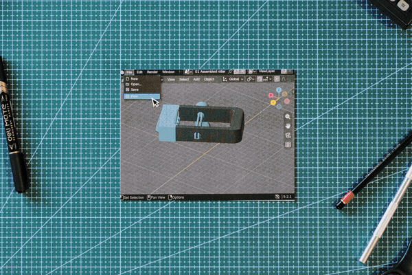
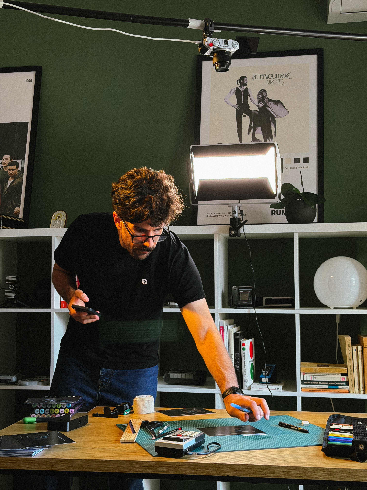
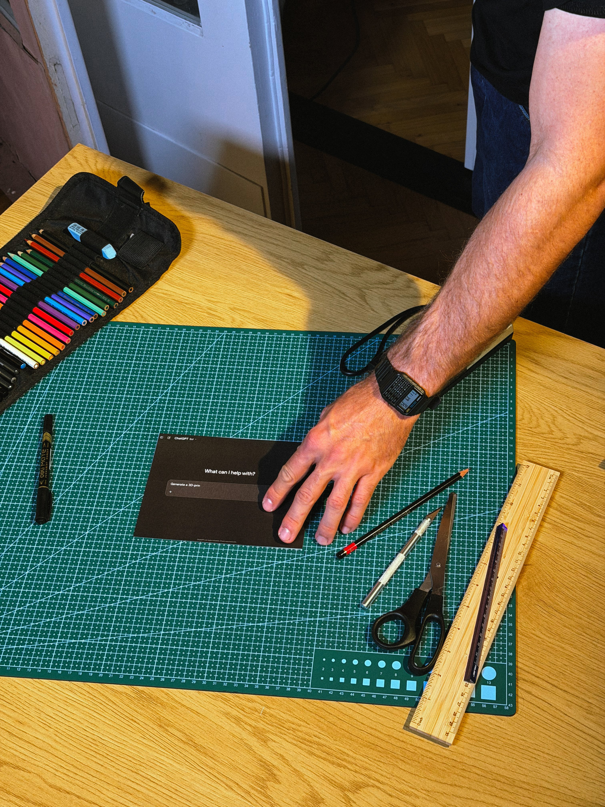

# hyperframes stop-motion

a paper stop-motion experiment, shot on a fuji x-m5 and edited with hyperframes + grok 4.7.

[](media/stopmotion-final.mp4)

[watch / download the final video](media/stopmotion-final.mp4) · 55.5s · 1620 × 1080

<p>
  
  
</p>

## run

node.js 22+ and ffmpeg.

```sh
npm run dev      # preview
npm run check    # validate
npm run render   # export at 24 fps
```

`index.html` mounts the photo sequence and curved credits in `compositions/`, all 231 source frames are in `assets/photos/`.

music: *last train to london* — electric light orchestra, [asset credits](THIRD_PARTY_NOTICES.md).
